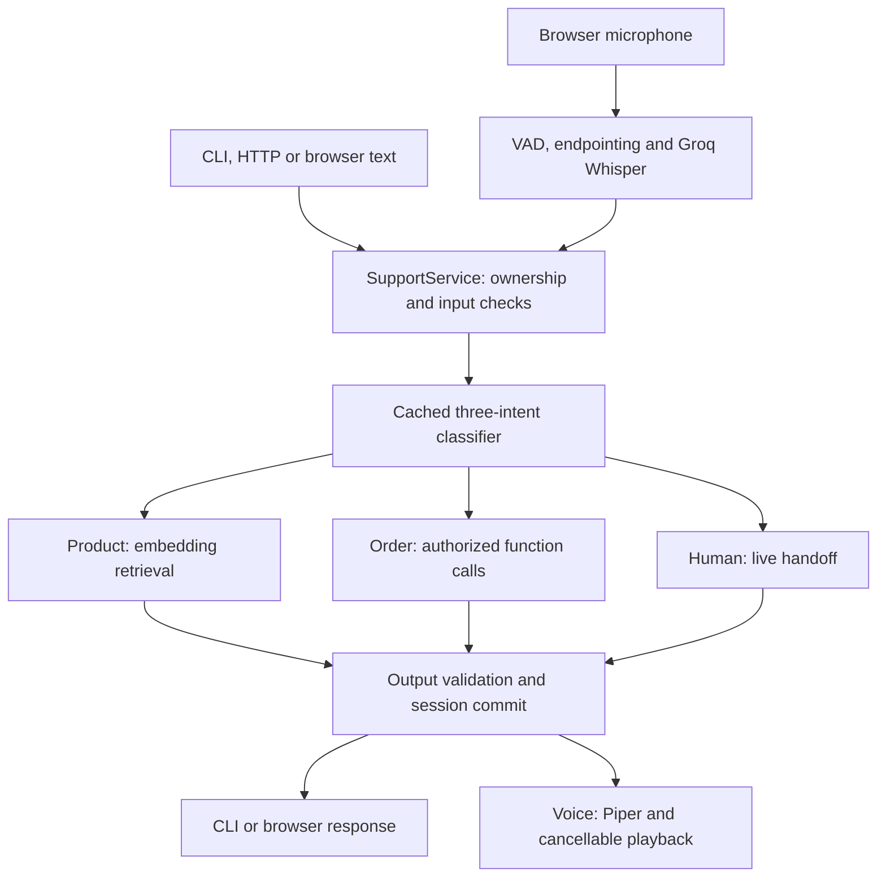

# Aegis architecture

A single Python application serves CLI, HTTP, browser text and browser voice. `bootstrap.py` constructs shared dependencies; every business turn enters `SupportService`. FastAPI serves the frontend directly—there is no separate frontend application or build server.

## Request flow

An input-check failure blocks dispatch. RAG expands matched embedding chunks into their source documents. Tool answers use recorded, authorized evidence; return eligibility is distinct from refund initiation. Escalation persists a handoff and enters `waiting_for_human`. Admin claim enters `human_active`; ending the handoff persists an extractive resolution and resumes `active`. Customer termination closes both sides. Messages in human states go to the operator without AI dispatch.

## Core files

Paths below are relative to `src/support_assistant/`. Package `__init__.py` files provide import boundaries.

| Files | Responsibility |
| --- | --- |
| `config.py` | Load `.env` and validate shared settings; environment variables take precedence. |
| `bootstrap.py` | Assemble and close one runtime: Groq, Redis, retrieval executor, handlers and speech resources. |
| `entrypoints/cli.py` | `chat`, `ask`, `metrics`, `build-index`, `retrieve`, `serve` and `voice` commands. `aegis-rag` is a compatibility alias. |
| `entrypoints/api/app.py` | FastAPI lifecycle, HTTP authentication, sessions/messages, health and admin endpoints; mount static frontend. |
| `entrypoints/api/voice.py` | Same-origin authenticated WebSocket, PCM/control validation, connection limits and playback acknowledgments. |
| `entrypoints/web/index.html`, `style.css` | Basic responsive text-and-voice support interface. |
| `entrypoints/web/app.js`, `capture-worklet.js` | Session transport, microphone resampling/framing, playback queue, interruption and client timing. |
| `application/support_service.py` | Sole guarded business-turn pipeline, session lease/replay, routing, response finalization and persistence. |
| `application/{human_support,history}.py` | Authorized handoff lifecycle, shared bounded history, admin replies, extractive resolution and customer termination. |
| `entrypoints/web/{admin.html,admin.js}` | Authenticated operator inbox, first-message summary, bidirectional chat, end handoff and opt-in failure controls. |
| `voice/faults.py` | Admin-only, expiring, one-shot STT/TTS demonstration failures. |
| `scripts/evaluate_live_system.py` | Consolidated actual-provider evaluation and incomplete-run reporting. |
| `application/guarded_dispatcher.py` | Require a matching signed approval before calling a registered handler. |
| `application/response_service.py` | Verify RAG/tool evidence; render controlled transactional responses and exact required wording. |
| `application/ports/{llm,embeddings,audio,speech_to_text,text_to_speech}.py` | Typed interfaces for injected providers and channel dependencies. |
| `domain/{conversation,evidence,orders,routing,safety,errors}.py` | Session/turn/response models, evidence, routing results, approval authority and domain failures. |
| `routing/{classifier,cache_key,registry}.py` | Three intents, context-aware classifier cache keys and Groq classification. |
| `agents/{product_question,order_status,human_escalation}.py` | Distinct handlers for knowledge questions, order tools and escalation. |
| `safety/{regex_guard,input_guard,output_guard,authorization,safe_responses}.py` | Input blocking, semantic checks, grounding, ownership enforcement and fixed response messages. |
| `tools/{schemas,registry,executor,get_order_status,check_return_eligibility}.py` | Tool schemas/allowlist, authorized execution, evidence vault and read-only order logic. |
| `rag/{documents,chunking,indexing,retriever,grounding,citations}.py` | Markdown loading, chunking, index metadata validation, embedding retrieval, grounded drafting and citations. |
| `adapters/groq/{client,speech_to_text}.py` | Asynchronous Groq chat/function calling and bounded Whisper transcription. |
| `adapters/embeddings/sentence_transformer.py`, `adapters/retrieval/numpy_index.py` | Local embedding model and normalized vector index persisted as NumPy/JSON files. |
| `adapters/persistence/{redis_sessions,fixture_orders}.py` | Shared sessions/leases/replay/intake and the demo order repository. |
| `adapters/cache/redis_cache.py` | Bounded classifier cache, request coalescing and hit-rate counters. |
| `adapters/audio/{silero_vad,codecs}.py` | Per-call VAD state and PCM/WAV conversion. |
| `adapters/tts/{piper,piper_worker,local_recovery}.py`, `recovery/*.wav` | Killable native synthesis, framed PCM streaming and provider-independent recovery recordings. |
| `voice/{coordinator,endpointing,audio_buffer,turn_tracker,state,events}.py` | Voice lifecycle, speech boundaries, pre-roll, playback generation invalidation, accepted FIFO jobs and explicit turn outcomes. |
| `voice/{resources,settings,playback_controller}.py` | Speech-provider capacity, model configuration, bounded audio window and cancellation timing. |
| `observability/logging.py` | Structured operational JSON logs without ordinary customer text, audio or secrets. |
| `prompts/*.md`, `manifest.json` | Guard, classifier, product and order instructions plus versioned prompt hashes. |

## Repository files

| Path | Purpose |
| --- | --- |
| `README.md` | Fresh-checkout setup, running, testing and troubleshooting. |
| `pyproject.toml` | Package/dependencies, optional voice/dev extras, entry points, packaged assets and Ruff rules. |
| `compose.yaml` | Local Redis only, with persistent data and a health check. |
| `configs/environment.example` | Configuration reference; copy only when creating a new `.env`. Runtime configuration comes from environment/Settings, not YAML files. |
| `data/knowledge_base/`, `AEGIS_KB_README.md` | Fifteen source documents, corpus manifest and content/provenance guide. |
| `data/fixtures/orders.json` | Read-only orders and ownership/refund state for the demo. |
| `scripts/setup_voice.py` | Explicit download and checksum verification of VAD/Piper models. |
| `scripts/{evaluate_retrieval,evaluate_support,run_evaluation}.py` | Retrieval/live support evaluation; `run_evaluation.py` is a compatibility wrapper. |
| `scripts/{run_support_scenarios,benchmark_support}.py` | Scripted support walkthrough and storage/coordination benchmark. |
| `scripts/{run_voice_scenarios,summarize_voice_latency}.py` | Six paced audio scenarios and latency statistics by metric. |
| `evaluation/runners/{grounding,support}.py`, `evaluation/datasets/` | Actual evaluation implementations and labeled development cases. |
| `tests/{unit,integration,fakes,fixtures,frontend}/` | Regression tests, isolated provider doubles, synthetic audio and browser/Node checks. |
| `docs/` | Detailed support/RAG/voice design, demo instructions, limitations, decisions and prior validation. |
| `evidence/` | Historical validation outputs; modes distinguish scripted providers, virtual audio and live execution. |

## State and resource boundaries

- **Redis:** authoritative session state, leases, turn replay, classifier cache/counters and queued support intake. Customer ownership is checked server-side.
- **Local files:** KB, demo orders, index (`var/indexes/aegis`) and downloaded speech models (`var/models`). KB or embedding-setting changes require index rebuilding.
- **Per voice connection:** transient PCM/pre-roll, endpoint/VAD state, bounded jobs and playback generation. Interruption cancels obsolete audio, not a committed business operation.
- **External:** Groq chat and Whisper. Embeddings, VAD and Piper inference run locally after model download.

Defaults are a demo, not a production phone carrier, payment integration, production staffing or measured 10,000-call deployment. See [limitations](docs/limitations.md), [support design](docs/support-design.md) and [voice design](docs/voice-design.md).
